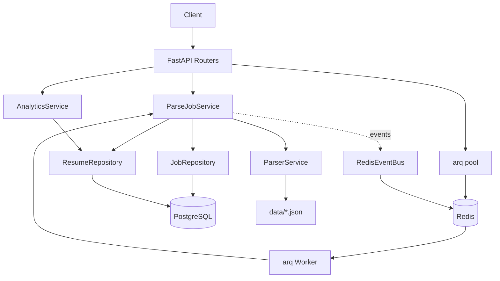

# Architecture

## Layers



## Layers

### Domain
- Pure Python, no dependencies on FastAPI / SQLAlchemy.
- Entities: `ParseJob`, `Resume`, `JobStatus`, `JobCompleted`, `JobFailed`.
- Invariants: state transitions (`PENDING → RUNNING → COMPLETED/FAILED`).
- Exceptions: `JobNotFound`, `JobNotCompleted`, `InvalidJobState`, `ParseError`.

### Application
- Use cases: `ParseJobService`, `AnalyticsService`.
- Orchestrates domain + infrastructure.
- No knowledge of HTTP.

### Infrastructure
- `SqlJobRepository`, `SqlResumeRepository` (SQLAlchemy async).
- `RedisEventBus` (Redis Pub/Sub).
- `ParserService` (reads JSON files from `data/`).

### Presentation
- FastAPI routers (`jobs`, `analytics`).
- Pydantic schemas (`JobResponse`, `ResumeResponse`, ...).

### Workers
- `arq` worker processes `parse_job_task`.
- Separate process from API. Own DB session.

## Dependency flow

```
Presentation → Application → Domain
                  ↓
           Infrastructure
```

**Forbidden:**
- Domain → Application (cycle).
- Domain → Infrastructure (leak).
- Parser → Jobs (cycle).

## Data flow

### Create and process a parse job

1. Client calls `POST /jobs`.
2. `ParseJobService.create` creates a `ParseJob` (PENDING) and persists via `JobRepository`.
3. `get_arq_pool` enqueues `parse_job_task(job_id)` to Redis.
4. Worker picks up the task.
5. `ParseJobService.run`:
   - `job.start()` → RUNNING.
   - `ParserService.search_all()` reads JSON from `data/`.
   - `ResumeRepository.save_many()` persists resumes.
   - `job.complete(items_count=len(resumes))` → COMPLETED.
   - Pull events → publish `JobCompleted` via `RedisEventBus`.
6. Client polls `GET /jobs/{id}` or subscribes to Redis events.

### Analytics

1. Client calls `GET /analytics/salary/average?area_id=1&keyword=python`.
2. `AnalyticsService` delegates to `ResumeRepository.average_salary`.
3. `ResumeRepository` runs SQL `AVG(salary_amount)` with filters.
4. Response includes `average` and `count` (resumes with salary).

## Tech stack

| Layer | Tech |
|---|---|
| Language | Python 3.12 |
| Web | FastAPI, Uvicorn |
| Validation | Pydantic v2 |
| DB | PostgreSQL, SQLAlchemy 2.0 (async), asyncpg, Alembic |
| Background | arq, Redis |
| Events | Redis Pub/Sub |
| Tests | pytest, pytest-asyncio, httpx |
| CI | GitHub Actions (ruff, mypy, pytest, coverage) |
| Deploy | Docker, Docker Compose |